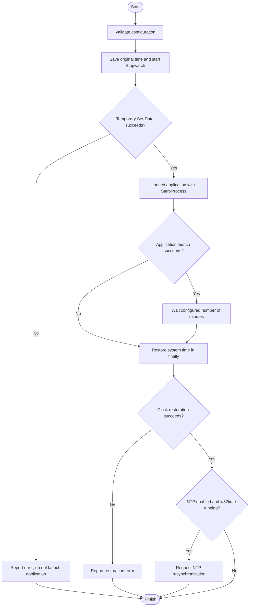
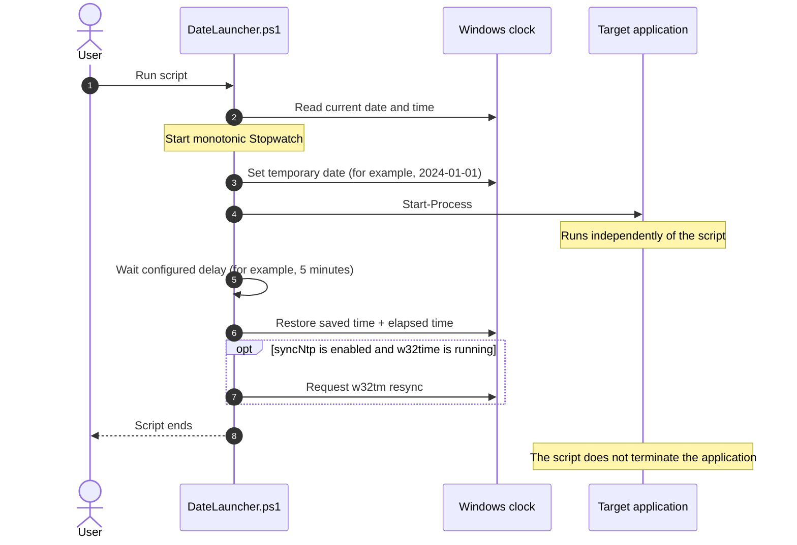

# Windows Date Launcher

**Launch a Windows application with a temporary system date, then automatically restore the current date after a configurable delay.**

Windows Date Launcher is a small PowerShell utility for testing and running applications that need a particular system date at startup. It changes the Windows clock, launches the application, displays a countdown, then restores the clock. The application is **not closed** when the script finishes.

> [!WARNING]
> **Use in a dedicated test VM whenever possible.** Changing the system date affects the entire Windows instance, not just the launched application. It can disrupt authentication, TLS certificates, scheduled tasks, logs, synchronization, and time-sensitive records.

## Features

- Configure the **application path**, **temporary date**, and **delay** in one place.
- Keep the **current time of day** while applying a specified date (`YYYY-MM-DD`).
- Launch the application with `Start-Process`, independently of the PowerShell script.
- Display colored status messages and a countdown progress bar.
- Restore the original time **plus actual elapsed time**, measured with a monotonic `Stopwatch`.
- Optionally request an NTP resynchronization if the Windows Time service is already running.
- Attempt clock restoration in a `finally` block if an error occurs after the clock changes.
- **No automatic changes** to Windows services or virtual-machine settings.

## Requirements

- Windows 10, Windows 11, or a compatible Windows Server installation.
- Windows PowerShell 5.1.
- Permission to change the system time (`SeSystemtimePrivilege`). Depending on your account and local policy, an **elevated PowerShell** session may be required.
- An accessible Windows application executable (`.exe`).

## Quick start

1. Download `DateLauncher.ps1` and place it in a folder, for example `C:\Scripts\`.
2. Edit the **CONFIGURATION** section at the top of the script:

   ```powershell
   # Full path to the application executable
   $appPath = 'C:\Apps\MyApplication.exe'

   # Temporary date (YYYY-MM-DD)
   $targetDate = '2024-01-01'

   # Delay in minutes before clock restoration
   $waitMinutes = 5

   # Request NTP synchronization at the end, if w32time is running
   $syncNtp = $true
   ```

3. Run from PowerShell:

   ```powershell
   powershell.exe -NoProfile -ExecutionPolicy Bypass -File "C:\Scripts\DateLauncher.ps1"
   ```

   Run with sufficient permissions for `Set-Date`. `-ExecutionPolicy Bypass` applies only to this PowerShell invocation; use only with scripts you trust.

## How it works

The flowchart shows the actual execution paths, including errors and clock restoration.



### Timeline



**Example:** If Windows initially reports `2026-11-17 14:30:00` and the configured temporary date is `2024-01-01`, the script sets `2024-01-01 14:30:00`, launches the application, then restores approximately `2026-11-17 14:35:00` after five minutes (plus processing time).

> [!NOTE]
> The target date is applied to the **entire Windows instance**, not just the application. The script retains the original time of day when constructing the temporary date.

## Create a desktop shortcut

Create a new Windows shortcut and use this target, adjusting the script path:

```text
powershell.exe -NoProfile -ExecutionPolicy Bypass -File "C:\Scripts\DateLauncher.ps1"
```

Select **Normal window** if you want to see the countdown. If your account lacks the required privilege, configure the shortcut to **Run as administrator** or grant the appropriate Windows user right through local security policy.

## Time synchronization

Windows or virtual-machine integration tools can undo a temporary date change **before the countdown finishes**. The script does not disable these mechanisms.

### Windows Time (`w32time`)

The Windows Time service runs under `svchost.exe`. In an isolated test environment, you can temporarily disable it from an **elevated** PowerShell:

```powershell
Stop-Service w32time -Force
Set-Service w32time -StartupType Disabled
```

Re-enable it later when needed:

```powershell
Set-Service w32time -StartupType Manual
Start-Service w32time
w32tm /resync /rediscover
```

> [!IMPORTANT]
> Do **not** stop or disable `svchost.exe`. Windows services share this host process. Disabling `w32time` is a separate administrative action and may not be suitable for domain-joined machines.

### Virtual machines

Guest integration components such as VirtualBox Guest Additions, VMware Tools, or Hyper-V integration services may synchronize time independently of `w32time`. If the date is immediately reset, check your hypervisor's time synchronization settings. For VirtualBox, the relevant process often appears as `VBoxService.exe` in Windows time-change logs.

### Diagnosing an automatic clock reset

If Windows reverts to the actual date before the countdown completes, use the following diagnostic path. Do not stop `svchost.exe` itself.

```mermaid
flowchart TD
    A["Temporary date is reset early"] --> B["Inspect Security event 4616"]
    B --> C{"Which process changed the clock?"}
    C -- "svchost.exe" --> D["Check Windows Time service: w32time"]
    C -- "Guest tools process" --> E["Check VM time-sync configuration"]
    C -- "Other process" --> F["Investigate that process or scheduled task"]
    D --> G["Retest in an isolated environment"]
    E --> G
    F --> G
```



```powershell
Get-WinEvent -FilterHashtable @{
    LogName = 'Security'
    Id = 4616
} -MaxEvents 10 | Format-List TimeCreated, Message
```

Event 4616 availability depends on audit policy. The process name is useful evidence, but it does not always identify the underlying configuration by itself.

### NTP at the end

When `$syncNtp = $true`, Date Launcher runs `w32tm /resync /rediscover` **only if `w32time` is running**. If the service is stopped or disabled, it skips NTP; restoration still uses the original date and elapsed time. A successful resync request does not guarantee that a time source applied a correction.

## Troubleshooting

| Symptom | What to check |
| --- | --- |
| `Set-Date`: *A required privilege is not held by the client* | Run with elevation or grant `SeSystemtimePrivilege` to the account. |
| Date jumps back immediately | Check `w32time` and VM guest time synchronization. |
| Application not found | Check `$appPath` and confirm that the `.exe` exists. |
| NTP skipped | `w32time` is not running; stopwatch-based restoration still works. |
| No automatic restoration after closing PowerShell | The script must remain running until the countdown completes. |

For time-change events, see [Diagnosing an automatic clock reset](#diagnosing-an-automatic-clock-reset).

## Limitations and safety

- **The date change is system-wide.** Do not use on a production workstation or an actively used accounting system without assessing the consequences.
- **Keep PowerShell running** until restoration finishes. A forced termination, power loss, or OS restart can prevent the `finally` block from executing. This is not a persistent watchdog or recovery service.
- `Start-Process` does not intentionally terminate the application; the application may still quit by itself.
- Clock restoration is an **estimate based on elapsed time**, not an authoritative time source. It may differ slightly from real time; NTP can correct it when available.
- Avoid creating or modifying time-sensitive records while the clock is intentionally set to the temporary date.
- The script does not restore or reconfigure Windows services or hypervisor settings.

## License

Distributed under the **MIT License**. See [LICENSE](LICENSE) for the full text.

Copyright (c) 2026 Windows Date Launcher contributors.
